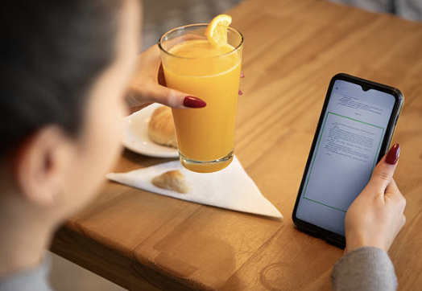

# Accessible Alt-Text 🔍
  

## Overview

*Accessible Alt-Text is a beginner-friendly Python web application that generates descriptive alternative text (alt text) for images. It’s designed to improve accessibility for blind and visually impaired users by providing meaningful image descriptions that adhere to ethical guidelines, combined with a Chrome extension that reads alt text aloud for enhanced accessibility.

This project serves as a starting point for integrating AI-powered alt text generation while keeping ethical considerations around identity and representation at the core.*

---


*Demo screenshot from the unsplash.com*

---

## 💖 Personal Story & Motivation

My name is Brenda Iradukunda, and I’m currently a senior at Washington and Lee University, majoring in Computer Science and Economics.

In the summer of 2024, I worked on a research project with Professor Rachel Levit Ades, a philosophy professor whose work focuses on accessibility and disability studies. Our project explored the ethical complexities of AI-generated image descriptions for blind and low-vision users, especially when those images include people.

We found that many existing image description tools avoid describing race, gender, or disability status, not because these categories are irrelevant, but because they’re ethically complicated. And yet, omitting them can also be harmful: it can erase identity, reinforce default assumptions, and exclude blind users from fully participating in visual culture.

While I didn’t do the programming during the research, the ethical questions we asked stayed with me. After the program, I began experimenting with this tool on my own, and in 2025 I started building it in earnest.


---

## ⚙️ Features

- 📸 Input image URL and receive a generated alt text description
- ✍ ️ Clean and simple web interface built with Flask and HTML
- 🌐 Modular Python codebase for easy extension and AI integration
- 🧠 Ethical approach to alt text generation, with plans to incorporate context-aware models
- 🔈 Future support for text-to-speech and file uploads

---

## 🧗 Challenges & What I Learned

- Learning how Flask handles form data and templates
- Organizing Python files for modularity (hello, `alt_text_generator.py`)
- Thinking deeply about ethical, *not just technical*, design
- Writing a README that actually tells a story 

---

## 🚀 Roadmap

- [ ] Integrate HuggingFace BLIP model for alt text generation  
- [ ] Add file/image upload support  
- [ ] Convert alt text to speech (TTS)  
- [ ] Improve styling and keyboard navigation for screen readers  
- [ ] Publish as an open-source accessibility starter project  

---

## 🔧 Tech Stack

- Python 3.9+
- Flask
- HTML
- Future: HuggingFace Transformers, TTS, OpenAI Vision


## Project Structure

- alt_text_app/
- app.py
- alt_text_generator.py
- templates/
- index.html
- result.html

## Usage

1. Clone the repo:
```bash
git clone https://github.com/iradukundabrenda/Accessible-Alt-Text.git
cd Accessible-Alt-Text
pip install -r requirements.txt
python app.py
```

2. Open http://127.0.0.1:5000 in your browser, or load the extension in Chrome (chrome://extensions → Load unpacked) and click any image to hear its description.

